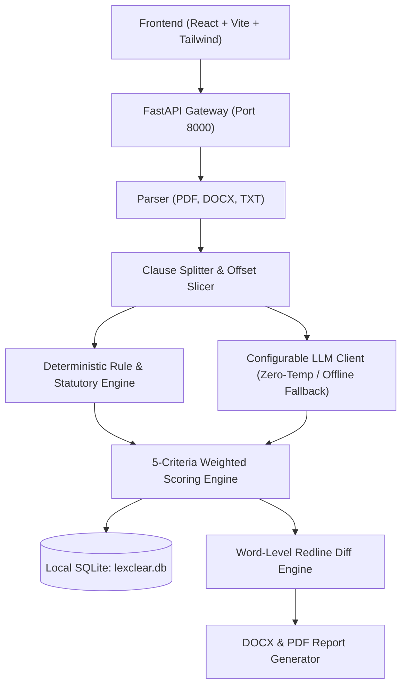

# ⚖️ LexClear — AI-Powered Legal Document Analyzer, Corrector & Generator

[](https://www.python.org/)
[](https://fastapi.tiangolo.com/)
[](https://react.dev/)
[](https://tailwindcss.com/)
[]()

> **Informational Notice:** LexClear provides transparent AI contract analysis, mathematical risk scoring, and guided drafting tools. It does not constitute formal legal representation or legal advice.

---

## 🌟 Core Modules & Capabilities

### 1. 🔍 Explainable Scoring Engine (Zero Black Boxes)
- Evaluates documents across **5 weighted criteria** (Clarity 25%, Completeness 20%, Fairness 20%, Legal Risk 25%, Compliance 10%).
- Displays the exact mathematical ledger: `Base 100 → -20 (Unlimited Liability) → -15 (Sole Arbitrator) = 65.0`.
- Radar polygon visualization and color-coded risk bands (**Low Risk / Safe to Sign**, **Medium Risk / Needs Review**, **High Risk / Do Not Sign As-Is**).
- 100% deterministic reproducibility via document SHA-256 caching.

### 2. 📖 Click-to-Explain (Layman Mode)
- Click any clause to view a **Grade 8 reading level** plain-English summary.
- **"What this means for you"** section with real-life scenario impact.
- **Legal Terms Jargon Buster** with interactive definitions.
- **"Questions to Ask a Lawyer"** consultation checklist.
- **English / Hindi** translation toggle.

### 3. ✍️ Auto-Correct with Redline Diff
- Generates balanced, legally enforceable alternatives based on established statutory doctrines.
- Inline and side-by-side **redline diff visualizer** (red strikethrough for removals, green highlight for insertions).
- Per-change **Accept / Reject / Edit** controls, plus **"Accept All"** and **"Reset"**.
- Live before-and-after re-scoring comparison with delta point gains.
- Export finalized documents as **Clean DOCX**, **Tracked Changes DOCX**, or formatted **PDF**.

### 4. 🧙 Guided Legal Document Generator
- 6 standard contract templates: **Mutual NDA**, **Commercial & Residential Lease**, **Executive Employment**, **Freelance & Services Agreement**, **Sale Agreement**, and **Power of Attorney**.
- Dynamic guided input fields with jurisdiction selector.
- Optional clause library with layman explanations.
- Real-time pre-export score audit before downloading.

### 5. 📊 Interactive Schematics & Documentation
- Interactive schematic diagram viewer covering:
  1. *Full-Stack Architecture*
  2. *Document Analysis Pipeline*
  3. *Mathematical Scoring Derivation*
  4. *Auto-Correction & Redline Loop*
  5. *Contract Generator Flow*
  6. *Data Privacy & Sovereignty Lifecycle*

---

## 📐 System Architecture



---

## 🧮 Scoring Methodology & Formula

```text
Overall Score = 0.25*Clarity + 0.20*Completeness + 0.20*Fairness + 0.25*LegalRisk + 0.10*Compliance
```

| Criterion | Weight | Evaluated Vulnerabilities & Focus |
| :--- | :---: | :--- |
| **Clarity** | 25% | Ambiguous wording, undefined terms, scope creep, archaic legalese |
| **Completeness** | 20% | Essential protective clauses checklist for the detected contract type |
| **Fairness** | 20% | Asymmetric liability caps ($10 vs unlimited), one-sided termination, deposit forfeiture |
| **Legal Risk** | 25% | Uncapped liability, unilateral sole arbitrator, unlawful non-compete, waiver of fraud suit |
| **Compliance** | 10% | Offshore tax haven clauses, stamp duty evasion, registration formalities |

---

## 🚀 Quickstart & Installation

### Prerequisites
- Python 3.10+
- Node.js 18+ (for frontend development/rebuilding)

### 1. Environment Setup
```powershell
# Copy environment configuration
copy .env.example .env

# (Optional) Add your API key in .env or run in default 100% offline deterministic mode
```

### 2. Install Dependencies
```powershell
# Python backend dependencies
pip install -r backend/requirements.txt

# (Optional) Frontend build dependencies
cd frontend
npm install
npm run build
cd ..
```

### 3. Launch Application
```powershell
# Start unified LexClear application
python run.py
```
- **Web Application URL**: [http://127.0.0.1:8000](http://127.0.0.1:8000)
- **Interactive Swagger Docs**: [http://127.0.0.1:8000/docs](http://127.0.0.1:8000/docs)
- **Health Check**: [http://127.0.0.1:8000/api/health](http://127.0.0.1:8000/api/health)

---

## 🧪 Running Automated Tests

Run the complete regression and end-to-end test suite:
```powershell
pytest backend/tests/
```

### Test Suite Summary
- `test_phase1_parsing_and_storage.py`: Multi-format parsing (PDF, DOCX, TXT), character offsets, and SQLite CRUD.
- `test_scoring_math.py`: Criteria weights invariant $(\sum w_i = 1.0)$, predatory contract detection, and deterministic repeatability.
- `test_explain_service.py`: Grade 8 layman synthesis, glossary terms, and Hindi language toggle.
- `test_diff_and_corrections.py`: Word diff token generation and live before/after re-scoring improvements.
- `test_generator_and_export.py`: 6 contract templates, pre-export score audit, clean & tracked-changes DOCX/PDF export.
- `test_e2e_pipeline.py`: Full end-to-end pipeline validation across all 4 sample fixtures.

---

## 🔒 Data Privacy & GDPR Compliance
- **Local SQLite Isolation**: Documents are stored exclusively in your local database (`lexclear.db`).
- **Zero Public Cloud Leakage**: In default offline mode, zero data is transmitted to third-party endpoints.
- **1-Click Shredder**: `DELETE /api/documents/{id}` and `DELETE /api/documents/purge/all` permanently wipe all document text, clauses, and analyses via cascading SQL deletions.
